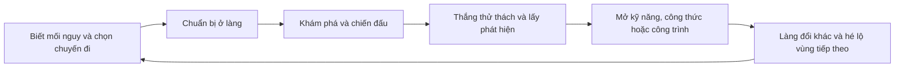

# Thung Lũng Sao Rơi — thiết kế phát triển phiêu lưu và chiến đấu

Ngày thiết kế: 13/10/2026. Cập nhật 14/10/2026: người dùng đã cho triển khai; bản chơi thử đầu tiên có sổ nhiệm vụ mới, nền chiến đấu và chương Rễ Sao. Các mục tiêu mở rộng, thời lượng và cân bằng dưới đây vẫn cần kiểm chứng. Xem trạng thái thực tế trong kế hoạch triển khai và `TEST_REPORT.md`.

## 1. Yêu cầu và kết quả mong muốn

Feedback của người dùng: nhiệm vụ ít hấp dẫn, nhiệm vụ hoàn tất làm rối danh sách, thử thách dễ, gameplay đơn giản và thiếu mục tiêu rõ ràng. Người dùng đã chọn **phiêu lưu nhiều chiến đấu, có boss**.

Đích phát triển: một game hành động pixel nhìn từ trên xuống, nơi người chơi khám phá bí ẩn Cơn Mưa Sao, giải phóng các vùng bị ảnh hưởng và xây Làng Ánh Sao thành căn cứ cho những chuyến thám hiểm. Mỗi chuyến đi phải đem về khả năng mới hoặc một thay đổi nhìn thấy được trong làng.

Các con số thời lượng, độ khó và lượng nội dung bên dưới là mục tiêu thiết kế ban đầu, cần kiểm chứng bằng chơi thử; không phải kết quả đo hoặc cam kết lịch phát hành.

## 2. Hiện trạng đã đối chiếu với mã ngày 13/10/2026

| Bề mặt | Hiện có | Hệ quả đối với kế hoạch |
|---|---|---|
| Nhiệm vụ | `game-data.js`: 24 cốt truyện, 24 việc cư dân, 12 mẫu hợp đồng ngày | Ưu tiên chất lượng tình huống và phần thưởng trước khi tăng số lượng |
| Sổ | `game.js`, `showJournal()`: dựng thẻ cho cả loại nhiệm vụ, bao gồm `claimed` và chưa mở khóa | Cần tách việc đang làm, việc có thể nhận và lịch sử |
| Tiến trình | `journeyProgress()` suy ra từ nhiệm vụ đã nhận thưởng; `claim()` gọi `resumeStory()` | Giữ nguyên chứng cứ tiến trình; tách hiển thị khỏi dữ liệu lưu |
| Chiến đấu | Mỗi vùng ngoài làng có 5 slime, cùng 3 HP; kiếm chọn mục tiêu gần trong bán kính 105 px; quái đuổi và gây sát thương tiếp xúc | Cần hướng đánh, báo trước đòn, né, hành vi địch và boss |
| Mục tiêu chiến đấu | Toàn bộ 60 định nghĩa nhiệm vụ có 3 mục tiêu `fight`, cùng nhắm `slime`; chuyện chính có 1 mục tiêu loại này | Chiến đấu chưa phải trụ cột của hành trình |
| Xây làng | 12 nâng cấp mua tại vị trí cố định; 4 công thức; 11 NPC | Tận dụng công trình và NPC để nối phát triển căn cứ với chiến đấu |
| Thế giới | Làng, rừng, bờ vịnh, tàn tích; đường, vật cản, ngày đêm, mưa, bia và rương | Đặt nội dung được thiết kế riêng trong các vùng hiện có trước |
| Online | Đồng bộ hiện diện/vị trí/chat; nhiệm vụ, kinh tế và quái ở client | Co-op đánh boss là dự án mạng riêng ở giai đoạn sau |
| Save/build | Save tiến trình v1, xuất/nhập qua `save-transfer.js`; client dùng allowlist chung | Mọi trường mới phải đi qua restore/export/import và build thật |

Đây là khảo sát mã nguồn và dữ liệu. Phiên lập kế hoạch này chưa chạy game trong trình duyệt, chưa đo thời gian chơi, hiệu năng hoặc mức độ vui.

## 3. Lựa chọn hướng phát triển

| Cách làm | Lợi ích | Đánh đổi |
|---|---|---|
| **Phát triển trên Canvas/JavaScript hiện có — chọn** | Giữ save, bản web/mobile, renderer, NPC và bộ kiểm tra; sớm có bản chơi để đánh giá | Cần tách logic chiến đấu khỏi `game.js` khi xây hệ thống này |
| Chỉ bổ sung nhiệm vụ và chỉnh phần thưởng | Ra bản cập nhật nhỏ nhanh | Không đáp ứng hướng chiến đấu có boss đã chọn |
| Viết lại bằng Godot | Có editor màn chơi/animation và quy trình xuất bản native | Phải chuyển renderer, điều khiển, save, mạng và kiểm tra; chậm kiểm chứng trải nghiệm |

Giữ công nghệ đang dùng. Xem xét Godot khi có yêu cầu phát hành native/editor rõ ràng hoặc có số đo cho thấy giải pháp hiện tại không đạt mục tiêu; không chuyển engine chỉ vì thêm boss.

Tham chiếu nguyên tắc: [Core Keeper](https://store.steampowered.com/app/1621690/Core_Keeper/) nối khám phá, trang bị, xây căn cứ và chiến đấu với Titan; [Necesse](https://necessegame.com/) nối phát triển khu định cư, chuẩn bị trang bị và chuỗi thử thách boss; [Moonlighter](https://store.steampowered.com/app/606150/Moonlighter/) gắn vai trò đời thường với hành trình phiêu lưu. Đề xuất áp dụng bên dưới là suy luận thiết kế cho Thung Lũng Sao Rơi, không phải sao chép nội dung hoặc cam kết đạt chất lượng thương mại tương đương.

## 4. Vòng chơi và ba tầng mục tiêu

- **Trong vài phút:** đến một địa điểm cụ thể, học một cách đối phó, mở đường tắt hoặc cứu một cư dân. HUD nói rõ việc làm, nơi đến, lý do và phần mở khóa.
- **Trong một phiên:** chuẩn bị và hoàn thành một chuyến thám hiểm; hạ địch tinh nhuệ hoặc boss, đem thành quả về làng. Mục tiêu phiên 20–40 phút, có điểm dừng an toàn.
- **Dài hạn:** khám phá nguồn gốc Vết Nứt Sao, đánh bại bốn thủ lĩnh và ổn định thung lũng. Đêm Hội Sao cùng Đèn Dẫn Sao giữ vai trò biểu tượng cho thành quả xây làng.

Tuyến hồi sinh làng hiện tại trở thành tuyến hỗ trợ được ghi rõ trong UI. Tuyến phiêu lưu mới là mục tiêu được đề xuất trên HUD sau phần mở đầu; người chơi vẫn được chủ động theo dõi nhiệm vụ khác. Mỗi màn hình chỉ nổi bật một bước tiếp theo.

## 5. Sổ nhiệm vụ: ưu tiên sửa đầu tiên

Ba chế độ: **Đang làm**, **Có thể nhận**, **Lịch sử**. Bộ lọc loại nhiệm vụ là điều khiển riêng, gồm tất cả/cốt truyện/việc cư dân/hợp đồng; thêm phiêu lưu khi hệ thống đó tồn tại.

1. Mặc định mở Đang làm. Nhiệm vụ đạt mục tiêu nhưng chưa nhận thưởng vẫn nằm ở đây, hiện nhãn **Sẵn sàng nhận thưởng**; nhiệm vụ giao đồ chỉ rõ NPC và vùng.
2. Chỉ sau khi nhận thưởng thành công, thẻ mới rời Đang làm/Có thể nhận và xuất hiện ở Lịch sử. Không xóa `state.quests[id]`.
3. Sắp xếp Đang làm: sẵn sàng nhận thưởng trước, nhiệm vụ theo dõi tiếp theo, rồi thứ tự dữ liệu ổn định. Có thể nhận chỉ chứa nhiệm vụ thực sự nhận được. Khóa tương lai được mô tả gọn trong tiến trình chương.
4. Số trên bộ lọc phản ánh danh sách thực tế. Sau khi nhận thưởng, giữ bộ lọc, cập nhật nhiệm vụ kế tiếp ngay và đưa focus tới thẻ còn lại/thông báo rỗng; tránh nhảy về đầu một danh sách dài.
5. Theo dõi thủ công một nhiệm vụ đang làm phải được giữ khi nhận thưởng nhiệm vụ khác. Khi nhiệm vụ theo dõi biến mất, chọn mục tiêu hợp lệ tiếp theo; không để HUD giữ ID đã xong/hợp đồng hết ngày.
6. Cốt truyện/việc cư dân có lịch sử lâu dài từ `claimed`. Hợp đồng hiển thị **Đã hoàn tất hôm nay**, tuân theo cơ chế reset ngày hiện có; P0 không bổ sung kho lịch sử hợp đồng vô hạn.
7. Danh sách rỗng có hành động cụ thể: xem việc có thể nhận hoặc xem bước mở khóa kế tiếp. Không ép mở sổ nhiều lần để tìm việc mới.

## 6. Chiến đấu: độ khó đến từ quyết định và kỹ năng

Nền tảng đầu tiên: kiếm theo hướng nhìn, bước né, đòn được báo trước, va chạm đúng vật cản và khoảng trống hồi phục sau đòn. Giữ chạy miễn phí như điều khiển hiện tại. Mỗi đòn chỉ gây sát thương một lần cho mỗi mục tiêu; xuyên tường và gây nhiều hit do FPS là lỗi phải chặn.

Thông số khởi điểm cho bản chơi thử, chỉnh lại sau quan sát:

| Cơ chế | Khởi điểm |
|---|---|
| Kiếm | Tầm 78 px, cung 100°, chuẩn bị 0,10 s + có hit 0,12 s + hồi 0,18 s; tốn 2 thể lực |
| Né | 0,22 s, tốc độ 360 px/s, miễn sát thương 0,16 s đầu; hồi 0,8 s; tốn 10 thể lực; dừng ở vật cản |
| Hồi thể lực chiến đấu | 6 điểm/s sau 0,8 s không dùng động tác tốn thể lực; đồng hồ này chỉ chạy khi game đang hoạt động |
| Đòn mạnh của địch | Báo trước tối thiểu 0,6 s; hình vùng nguy hiểm + tư thế, có âm báo bổ trợ |
| Boss đầu | Khoảng 60–120 s với trang bị phù hợp; thắng bằng đọc đòn và né, không cần vật phẩm rơi ngẫu nhiên |

Ba vai trò địch cho chương đầu: slime lao sau khi lấy đà, mầm gai bắn đường thẳng, hộ vệ rễ cây chậm và có khoảng nghỉ sau đòn nặng. Mỗi loại cần phản ứng khác; bẫy địa hình và cặp địch tạo chiều sâu tiếp theo.

Boss rừng **Hộ Vệ Rễ Sao**: chu kỳ quét rễ → lao → lộ lõi; dưới 50% máu thêm nhịp tấn công thứ hai có báo trước. Người chơi học từng đòn ở quái thường trước trận boss. Trận đấu có điểm hồi sinh gần đó và lối rút lui an toàn ngoài trạng thái giao tranh.

Desktop: Space đánh, V né, E tương tác; mobile thêm nút Né 44 px bên cạnh bộ điều khiển hiện có. Kiểm bốn nút đánh/né/tương tác/chạy ở 568×280 trước khi chốt bố cục. Cung/thương chỉ thêm sau khi kiếm và né đã đạt chất lượng; hỗ trợ ngắm theo hướng di chuyển và trợ ngắm trong cung hợp lệ trên cảm ứng.

Giảm chuyển động tắt rung màn hình và chớp mạnh nhưng giữ vùng nguy hiểm cùng tư thế địch dễ đọc. Mở modal/chat/câu cá, xoay dọc, ẩn tab, đổi vùng hoặc về title phải dừng và xóa input chiến đấu. Địch trong đấu trường không tiếp tục gây sát thương khi người chơi đang xem UI.

Thất bại giữ nhiệm vụ, công trình và chứng cứ hạ boss. Giai đoạn đầu giữ mức phạt 30 xu hiện có; đặt lại trận chưa thắng, hồi sinh gần điểm an toàn. Thử lại không đòi farm vé hoặc chạy lại một tuyến dài; mục tiêu quay lại trận trong 30 s.

## 7. Chương đầu để kiểm chứng độ hấp dẫn

Mục tiêu trải nghiệm: 30–45 phút từ save mới đến thắng boss rừng, về làng và sử dụng phần mở khóa. Đây là bản chơi hoàn chỉnh nhỏ nhất để đánh giá cả vòng chơi.

Giữ `story01`–`story24` cùng các ID và tiền đề đã lưu. Mở chuỗi `adv01`–`adv06` sau `story05` đã nhận thưởng. Save cũ đã qua bước này được nhận chuỗi mới khi tiếp tục; không bắt chơi lại phần mở đầu. Trong chương đầu, dùng khu vực được bố trí riêng trong bản đồ `forest`, giữ bốn region ID hiện tại.

| Nhiệm vụ mới | Tình huống | Bằng chứng hoàn tất/phần mở khóa |
|---|---|---|
| `adv01` Dấu rễ thức giấc | Mira chỉ mối nguy; Sen dẫn tới dấu vết ở rừng | Kiểm tra điểm dấu vết, mở thử thách hướng đánh |
| `adv02` Khoảng trống giữa hai đòn | Đấu tập với kẻ lao, hướng dẫn né trực tiếp | Hoàn thành cuộc chạm trán được kiểm soát, mở tuyến thám hiểm |
| `adv03` Người mắc kẹt bên đường mòn | Cứu cư dân bằng đánh địch hoặc mở lối vòng; không làm escort ở bản đầu | Cờ giải cứu duy nhất, mở trạm nghỉ ngoài rừng |
| `adv04` Ba mạch rễ | Khám phá ba điểm; một giao tranh, một cơ chế môi trường, một lối tắt | Ba điểm có ID riêng, kích hoạt cửa đấu trường |
| `adv05` Chuẩn bị cho Hộ Vệ | Chọn trang bị/hồi phục ở làng, trở lại bằng lối tắt | Có kiếm khởi đầu và mở lối đến boss; không bắt mua đồ ngẫu nhiên |
| `adv06` Hộ Vệ Rễ Sao | Boss hai pha, đọc đòn và né | Cờ thắng boss bền vững; mở nâng cấp xưởng và khôi phục một góc làng |

Thêm ba việc phụ ngắn có tác động: tìm người mất tích bằng dấu vết, khôi phục một lối đi, giải cơ chế để tìm di vật. Việc phụ cho lựa chọn trang bị/trợ lực hoặc câu chuyện NPC; không bắt buộc để thắng boss.

Boss thắng trước lúc nhận nhiệm vụ vẫn được công nhận từ cờ chứng cứ; nhặt vật liệu thông thường trước lúc nhận nhiệm vụ thu thập không được tự tính ngược. Đây là hai hợp đồng tiến trình riêng, phải được giải thích và kiểm tra rõ.

Phần mở khóa xưởng phải dùng được ngay trong phiên thắng boss. Không chặn thành quả này sau `story08`; dùng xưởng hiện có nếu đã xây, nếu chưa có thì nhiệm vụ trao đủ ngân sách/nguyên liệu cho phương án cơ bản, qua đúng API xây dựng. Hiệu quả nhìn thấy: góc làng được sửa, cư dân trở về và có công thức/trang bị hữu ích cho chặng sau.

## 8. Nội dung phát triển sau khi chương đầu đạt yêu cầu

Ngân sách nội dung mục tiêu cho bản phiêu lưu đầu tiên: **24 nhiệm vụ phiêu lưu mới, bốn chương × sáu nhiệm vụ; bốn boss; 12–16 hành vi địch; ba họ vũ khí; 12 nhiệm vụ mới thuộc ba chuỗi cư dân**. Giữ nội dung cũ để bảo toàn tiến trình; phân biệt trong UI với tuyến mới. Hợp đồng tận dụng 12 mẫu hiện có, bổ sung tình huống sau khi các hành vi cần thiết đã tồn tại. Số lượng là trần phạm vi dự kiến, không phải lý do để đưa nhiệm vụ lặp vào game.

| Chương | Trải nghiệm riêng | Boss/phần thưởng chủ đạo |
|---|---|---|
| I — Rễ Sao | Học chiến đấu, cứu cư dân, giải cơ chế và mở đường tắt trong rừng | Hộ Vệ Rễ Sao; xưởng và chuẩn bị trang bị |
| II — Vịnh Vỡ Sóng | Địch tầm xa, đường đi theo nhịp thủy triều có tín hiệu, chọn tuyến an toàn/mạo hiểm | Kẻ Giữ Thủy Triều; công cụ vượt địa hình và bến tiếp tế |
| III — Ký Ức Mây | Bẫy, cơ chế ánh sáng, địch phối hợp, đọc dấu vết Cơn Mưa Sao | Người Gác Kính Mây; công thức di vật và đài quan sát |
| IV — Vết Nứt Sao | Kết hợp kỹ năng đã học trong đấu trường cuối tại tàn tích | Trái Tim Sao Lạc; khép hành trình và mở thử thách tự chọn |

Độ khó tăng qua tổ hợp địch, không gian và cách đối phó. Trang bị mở cách chơi: kiếm linh hoạt, thương giữ khoảng cách, cung đổi vị trí; di vật ít ô buộc chọn giữa an toàn và sát thương. Tránh chỉ tăng HP hoặc đòi thu thập gấp nhiều lần.

Người chơi thấy làng phát triển theo bốn mốc: trại → nơi trú chân → căn cứ thám hiểm → thung lũng hồi sinh. Công trình y tế/bếp/xưởng/đài quan sát phục vụ quyết định chuẩn bị. Bản đầu dùng nền công trình có sẵn; bài trí theo ô và phân công một công việc cho NPC chỉ làm sau khi vòng chiến đấu được xác nhận hấp dẫn.

Sau kết thúc: đấu lại boss với một biến thể hành vi được báo rõ, truy tìm di vật, hoàn thiện căn cứ và các câu chuyện cư dân. Không dùng lịch đăng nhập hoặc hạn thực tế để ép chơi. Sự kiện phòng thủ làng, nếu làm về sau, phải do người chơi chủ động bắt đầu và không phá công trình đã lưu.

## 9. Dữ liệu, kiến trúc và giới hạn kỹ thuật

- P0 sửa sổ trong `game-core.js`/`game.js`/CSS, dùng module và bộ kiểm tra sẵn có; chưa thêm thư viện.
- Khi xây combat, tạo `combat-core.js` cho mô phỏng thuần và `combat-data.js` cho thông số địch/vũ khí/boss. Chỉ tách phần chiến đấu liên quan khỏi `game.js`; `game.js` vẫn nhận input, vẽ và nối thế giới hiện tại. Module giữ quy ước script defer/Node của dự án.
- Khi thêm tuyến mới, tạo `adventure-data.js` cho nhiệm vụ/chạm trán và `adventure-core.js` cho chứng cứ/mở khóa. Đăng ký định nghĩa vào dữ liệu chung trước khi tạo/restore state. Giữ core nhiệm vụ dùng chung; không viết một hệ thống nhận thưởng song song.
- Thêm `kind: 'adventure'` và mục tiêu kiểm tra dấu vết/cơ chế/chạm trán/boss qua registry allowlist, mở rộng `event()`/`progress()`/prerequisites/restore. Các ID slime cũ vẫn được công nhận cho nhiệm vụ cũ. Chứng cứ duy nhất dùng ID được kiểm tra, không tăng bộ đếm tùy ý từ UI.
- Save tiếp tục đọc v1; trường bổ sung có mặc định an toàn, gồm trang bị hợp lệ và danh sách chứng cứ/boss đã thắng. Không tăng version rồi để guard `raw.version !== 1` xóa tiến trình. Nếu cần đổi định dạng ở giai đoạn sau, phải có migration và bản xuất dự phòng trước khi ghi.
- Không lưu input, cooldown né, projectile, pha animation hoặc trạng thái boss đang đánh vào save. Tải lại đặt người chơi ở điểm an toàn và bắt đầu lại trận chưa thắng; giữ chứng cứ thắng và mọi thưởng đã nhận. Không tự reset tài nguyên/lịch sử cũ.
- Mỗi thưởng một lần phải có nguồn nhận duy nhất và cờ đã nhận bền vững. Boss có chứng cứ thắng trước, thưởng qua `claim()`; túi đầy giữ quyền nhận sau, không làm rơi vật phẩm chốt tiến trình. Đấu lại không nhân thưởng độc nhất.
- Mô phỏng combat dùng bước cố định 1/60 s, tối đa năm bước bù mỗi frame; tạm dừng/ẩn tab không cộng dồn tấn công. Các kiểm tra 30/60/120 FPS phải cho kết quả tương đương ở cùng chuỗi input.
- Thêm module/âm thanh/ảnh phải sửa đồng thời thứ tự script, `config/deployment.cjs`, build và kiểm tra CSP. Âm thanh cần nguồn hợp lệ, bật sau thao tác người dùng, có tắt tiếng; thêm quy tắc `media-src 'self'` khi thực sự có audio, giữ các giới hạn khác.
- Online giai đoạn này tiếp tục phục vụ cộng đồng. Co-op chiến đấu đòi server quyết định HP/hit/phần thưởng, mô hình phòng, đồng bộ reconnect và lưu bền vững; phải có thiết kế riêng trước khi đưa vào roadmap thực thi.
- Chú thích tiếng Việt cho hàm mới và logic phức tạp; giữ tên **Thung Lũng Sao Rơi** và chủ đề hiện tại.

## 10. Cổng chất lượng và kiểm chứng

| Nhóm | Tiêu chí để chấp nhận |
|---|---|
| Sổ nhiệm vụ | Nhận thưởng xong không còn thẻ trong Đang làm/Có thể nhận; lịch sử đúng; giao thiếu đồ không biến mất; bộ lọc/số đếm/focus đúng; tải lại giữ tiến trình |
| Save cũ | Kiểm save mới, giữa chuyện, trước/sau lễ hội, đang nhận daily và nhập/xuất; không mất xu/vật phẩm/công trình/nhiệm vụ đã xong |
| Combat | Hướng đánh, tường, nhiều mục tiêu, mỗi đòn một hit, hết thể lực, né sát vật cản, 30/60/120 FPS, chết cùng lúc boss và pause/input reset |
| Boss/phần thưởng | Tín hiệu dễ đọc, retry được, thắng trước lúc nhận nhiệm vụ được tính, nhận thưởng lặp bị chặn, túi đầy nhận sau được, tải lại trước/sau thưởng đúng |
| Mobile/UI | Desktop 1280×900; ngang 844×390, 568×320, 568×280; dọc 390×844 rồi xoay lại; fullscreen phóng/thu; mục tiêu, minimap và nút không chồng nhau |
| Mỹ thuật/âm thanh | Bốn hướng người chơi, đi/chạy và tất cả 11 NPC nếu sửa renderer; đêm/mưa/mưa đêm; reduced motion; tắt tiếng và không autoplay lỗi |
| Build | `node --check` cho JS thay đổi, `node --test tests/*.test.js`, `npm run build`; kiểm bản dist có đủ module và không phục vụ file riêng/server |
| Hiệu năng | Mục tiêu desktop 60 FPS, thiết bị mobile tham chiếu ít nhất 30 FPS ổn định trong cảnh đông; ghi thiết bị, p95 frame time và số entity. Không gọi mobile đạt nếu chỉ đo trên desktop |

Dùng localhost `?qa=1` và save QA riêng. Giữ scene `battle`, `finale`, `after`, `actors`; bổ sung scene có tên riêng cho sổ/các địch/boss/checkpoint khi triển khai. `TEST_REPORT.md` ghi lệnh, mã thoát, số pass/fail/skip, thao tác trình duyệt đã làm và giới hạn chưa xác minh. Bản giả lập không xác nhận Safari/iPhone thật.

Chơi thử chương đầu với mục tiêu 5 người ít quen game, quan sát thay vì hướng dẫn ngoài game. Cổng đề xuất: ít nhất 4/5 tự nói được mục tiêu kế tiếp sau 10 phút; 4/5 hiểu cách tránh đòn đầu sau tối đa ba lần thử; 4/5 hoàn tất vòng đi–boss–về làng với hướng dẫn trong game; điểm muốn chơi tiếp trung vị ít nhất 4/5. Mẫu này chỉ giúp tìm vấn đề sớm, không chứng minh giữ chân người chơi ở quy mô thị trường.

Nếu phần né/đọc đòn chưa vui, dừng mở rộng chương và chỉnh nền chiến đấu. Nếu boss vui nhưng hành trình chán, sửa bố trí, nhịp khám phá và phần thưởng. Nếu người chơi vẫn lạc mục tiêu, sửa chỉ dẫn/HUD trước khi thêm nhiệm vụ.

## 11. Phạm vi và rủi ro

Ưu tiên theo thứ tự: sổ sạch → cảm giác chiến đấu → chương đầu hoàn chỉnh → xây làng gắn phần thưởng → mở rộng chương → hoàn thiện phát hành. Chưa đưa vào bản đầu: thế giới vô hạn, AI sinh nhiệm vụ, co-op combat, PvP, nhiều cây kỹ năng, farming chuyên sâu hoặc viết lại engine.

Rủi ro lớn: art/animation/âm thanh tiêu tốn công; mobile thiếu chỗ điều khiển; thay đổi schema làm rơi save; kinh tế hiện có khiến trang bị mới quá rẻ hoặc nhiệm vụ quá dài; mở rộng dữ liệu trước khi combat đạt chất lượng. Mỗi mốc phải có bản chơi và tiêu chí dừng; chỉ ước lượng lịch các chương sau sau khi có tốc độ làm thực tế của chương đầu.

Kế hoạch thực hiện và checklist P0: [Development Implementation Plan](../plans/2026-10-13-adventure-development-plan.md).
